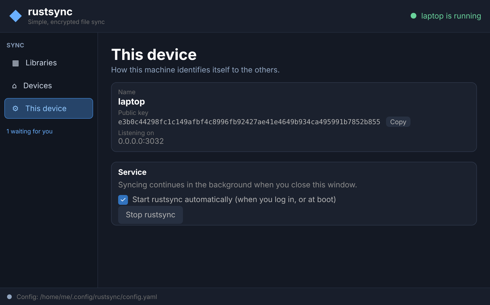

<p align="center"></p>

# !!!VIBE CODED CLANKER CODE!!!

# rustsync

**Simple, end-to-end encrypted file sync between your own computers.** Think of it as a small,
friendly cousin of Syncthing: pick a folder, share it with another machine, and the two keep it
identical. Nothing goes through anybody's cloud.

> **Please read this first.** This project was written almost entirely by an AI assistant and has
> had very little human review or real-world testing. It is a hobby project. Don't make it the only
> copy of anything you care about, and read [`SECURITY.md`](SECURITY.md) before you trust it.

- **Private by default.** Machines only talk to devices you paired yourself, over an encrypted
  connection. Strangers are dropped during the handshake.
- **Simple.** No accounts, no servers to sign up for, no config files to hand-edit. Pair with a
  one-time code, share a folder, done.
- **Encrypted backups.** Give a server an *encrypted* copy of a folder that it cannot read, and
  restore from it if every machine is lost.
- **Command line and a desktop window.** Everything the window does, the command line can do too.
  On Linux there is also a tray icon.

Contents: [How it works](#how-it-works-in-one-minute) ·
[Install](#install) · [Quick start](#quick-start-two-machines-one-folder) ·
[The desktop window](#the-desktop-window) · [All commands](#all-commands) ·
[Start at boot and the tray icon](#start-at-boot-and-the-tray-icon-linux) ·
[Encrypted backups](#encrypted-backups-for-a-server-or-if-everything-is-lost) ·
[Troubleshooting](#troubleshooting)

---

## How it works in one minute

Four words are all you need:

| Word | What it means |
|---|---|
| **Device** | One machine running rustsync (your laptop, your desktop, a home server). Each has a name. |
| **Pairing** | Introducing two devices once. One shows a **one-time code**, the other pastes it. After that they trust each other, and no one else. |
| **Library** | A named folder you sync, e.g. `photos` → `~/Photos`. You can have as many as you like. |
| **Sharing** | Offering a library to a paired device. The other side **accepts** it and picks a folder for it. Either it **syncs** the files, or (with `--backup`) it only keeps an **encrypted backup** it cannot read. |

```
  laptop                             desktop
 ~/Photos  <──── encrypted ────>   ~/Pictures/Photos      ← "photos" library, kept in sync
     │
     └──── encrypted backup ────>   home server            ← can't read it, only stores it
```

A small background program (the **service**) does the syncing. The command line and the desktop
window are just remote controls for it: you can close the window, or log out of the terminal, and
syncing carries on.

## Install

You need [Rust](https://rustup.rs) (1.81 or newer). Linux and macOS are supported (the service
talks to the tools over a Unix socket); the tray icon and start-at-boot are Linux-only.

```sh
git clone https://github.com/mrmoss/rustsync
cd rustsync
cargo build --release
```

This builds two programs into `target/release/`:

| Program | What it is |
|---|---|
| `rustsync` | the sync service and the command line |
| `rustsync-gui` | an optional desktop window (and tray icon) that controls the same service |

On a server with no screen, skip the window and its libraries:

```sh
cargo build --release --no-default-features
```

Put both programs somewhere on your `PATH` (for example `~/.local/bin`), **next to each other**:
the window looks for `rustsync` beside itself first.

## Quick start: two machines, one folder

You'll do the same few steps on both machines. Every command asks for whatever it needs if you
leave it out, so you can't really get it wrong. The examples call the machines **laptop** and
**desktop**.

**1. Start the service on both machines**

```sh
rustsync start
```

The first time, it asks which port to listen on (the default, 3032, is fine), creates its config
and keys, and names the device after the machine's host name. On Linux it also offers to start by
itself when you log in. After that it keeps running in the background.

**2. Pair them (once)**

On the laptop:

```sh
rustsync invite
```

It asks which address the other machine should use to reach this one (a name like `laptop` or an
address like `192.168.1.20` both work), then prints a **one-time code** and waits. On the desktop,
paste the code:

```sh
rustsync join
```

The two machines are now paired.

**3. Create a library and share it**

On the laptop:

```sh
rustsync create photos ~/Photos     # a library called "photos"
rustsync share photos desktop       # offer it to the desktop
```

**4. Accept it**

On the desktop:

```sh
rustsync accept                     # shows the offer; asks which folder to put it in
```

That's it: the folders now stay in sync, in both directions. Look at what's going on any time with:

```sh
rustsync status
```

## The desktop window

Prefer clicking? Start the window with `rustsync-gui` (it has a *Start* button if the service isn't
running yet). It has three pages:

- **Libraries**: your libraries, who they're shared with, how much encrypted-backup space is used,
  and offers waiting for you to accept.
- **Devices**: the machines you've paired and whether they're online, plus *Show a pairing code* and
  *Enter a pairing code* for adding another.
- **This device**: your name, public key, the address you're listening on, and the switch for
  starting rustsync automatically.

<p align="center">
  
</p>
<p align="center">
  
</p>
<p align="center">
  
</p>
<p align="center">
  
</p>

<sub>These pictures are drawn from the window's layout and colours with made-up example data (names,
paths and sizes), not captured from a real session, so details such as fonts will differ a little on
your machine.</sub>

The window uses `~/.config/rustsync/config.yaml` unless you give it another config with
`-c /path/to/config.yaml`, the same as the command line.

## All commands

Run `rustsync --help` (or `rustsync <command> --help`) for the full details. Every command takes
`-c <config.yaml>` to pick a config file; the default is `~/.config/rustsync/config.yaml`. Anything
you leave out is listed and asked for.

```
rustsync [-c CONFIG] <COMMAND>

Getting going
  start               Start the service in the background
  stop                Stop it
  status              Show this device, paired devices, libraries and waiting offers
  install-service     Start rustsync by itself at login / boot (Linux, systemd)
  uninstall-service   Stop doing that (also stops rustsync now)

Pairing devices
  invite [--host H]   Show a one-time code and wait for another machine to `join`
  join [CODE]         Pair with a machine that is waiting in `invite`
  forget [DEVICE]     Stop syncing with a paired device

Libraries (folders to sync)
  create [NAME] [FOLDER]            Create a library from a folder
  remove [LIBRARY]                  Remove it from this machine (files are not deleted)
  share  [LIBRARY] [DEVICE] [--backup]
                                    Offer a library to a paired device: synced, or
                                    (--backup) kept as an encrypted copy it can't read
  unshare [LIBRARY] [DEVICE]        Stop sharing with a device (files stay where they are)
  accept [OFFER] [FOLDER] [--quota SIZE]
                                    Accept a library another device shared with you
  decline [OFFER]                   Say no to an offer
  refresh                           Ask connected devices for their libraries again

Encrypted backups (see below)
  quota [LIBRARY] [SIZE]            Show or change the size limit of a backup kept here
  prune [LIBRARY]                   Delete old, unused data in the backups
  recovery [LIBRARY]                Show the recovery kit / recovery codes
  restore [CODE] [FOLDER] [--from DEVICE]
                                    Get a library back from an encrypted backup
```

Handy things to know:

- **"Number or name":** wherever a command asks for a device, library or offer you can type its
  number from the list, its name, or (for libraries) the start of its id.
- **Options without a command:** `rustsync` on its own runs the service in the foreground (useful
  for watching what it does); `rustsync --show-key` prints this device's public key.
- **Sizes** are written like `500G` or `2T` (decimal: 1 G = 1,000,000,000 bytes), or `none`.

## Start at boot and the tray icon (Linux)

The logo lives in `assets/` (`rustsync-icon.svg`, plus a single-colour `rustsync-symbolic.svg`);
the window, the tray icon and the application-menu entry all use it.

### Starting by itself

```sh
rustsync install-service        # start rustsync by itself (a systemd *user* service)
rustsync uninstall-service      # stop doing that (also stops rustsync now)
```

`install-service` writes `~/.config/systemd/user/rustsync.service` (other configs get their own
name), enables it and starts it. It restarts rustsync if it crashes, and logs to the usual
`daemon.log`. It then offers `loginctl enable-linger`, which is what makes it start at **boot**
instead of when you log in (`--yes` accepts). The first time you run `rustsync start` in a terminal
it offers this too (once). With the service installed, `start` and `stop` simply work with it. The
window's *This device* page and the tray menu have the same switch.

### The tray icon

`rustsync-gui` puts an icon in the system tray (StatusNotifierItem over D-Bus). It is in colour
when rustsync is running, **greyed out** when it is not, and gets a **blue badge** when libraries
are being offered to you. Click it (or choose *Open rustsync*) to get the window; closing the
window leaves the icon, and syncing, running. The menu also starts or stops the service and has
*Show this icon at login*.

```sh
rustsync-gui --tray      # only the icon, no window (what the login entry runs)
rustsync-gui --no-tray   # only the window
```

The service itself needs no desktop. The tray icon does, so it starts when you **log in to the
desktop** (not at bare boot): `install-service` also adds
`~/.config/autostart/rustsync-tray.desktop` (if `rustsync-gui` sits next to `rustsync`). The first
time the window opens it also adds a `rustsync.desktop` launcher and the icon under
`~/.local/share`, so rustsync shows up in your application menu with its icon (on Wayland that
entry is also what gives the window its icon).

The icon is its own small process, so it behaves the same on X11 and Wayland. It needs a desktop
that shows tray icons: KDE, Cinnamon, LXQt, Ubuntu's GNOME and sway/waybar do; plain GNOME needs the
"AppIndicator" extension; i3 needs `snixembed`. Without one, the icon exits quietly and the window
works as before. At login it waits a few minutes for the panel to be ready; what it did is written
to `tray.log` in the state directory. To build without it:
`cargo build --release --no-default-features --features gui`.

## Encrypted backups (for a server, or if everything is lost)

A library can be kept in two ways on another machine. With `share` the other machine syncs the
files like any device. With `share --backup` it only stores an **encrypted** copy it can't read.

```sh
# on the laptop that has the files
rustsync share files myserver --backup

# on the server: you pick where the encrypted data lives (e.g. another drive)
rustsync accept            # asks for a folder; nothing in it can be read on the server
```

- **Pairing later is fine.** If a machine is paired with the server *after* it got the library,
  it asks the machines it is connected to for their lists again and joins the backup by itself.
  `rustsync refresh` (the *Refresh* button) does the same by hand, e.g. if the other machine was
  offline at the time.
- **Other machines use it automatically.** Machines that sync `files` with the laptop learn about
  the backup and join it (if they are paired with the server). So when the laptop writes to the
  server and then goes offline, a machine that was off can start up, talk only to the server, and
  catch up. Changes reach online machines right away; others catch up when they connect.
- **Where it is stored** is chosen per backup when you `accept` (a suggested default is
  `backup_dir:` in the config, or `<state dir>/backups`). It is just a folder; put it on any drive.
- **Unsharing and re-sharing.** `rustsync unshare` (*Unshare…* in the window) stops sharing a
  library with a device; the files stay on both sides. Removing a library on one machine also tells
  the others, so the owner can simply `share` it again and you `accept` it again. For a backup you
  stopped serving, the device's next request shows up as an offer on the server (*Allow* /
  `accept`) and needs no new folder.
- **Size limit.** `accept` asks how much space the backup may use (e.g. `500G`, `2T`, empty = no
  limit). Change it any time with `rustsync quota` (or *Set limit…* in the window). `rustsync
  status` and the window show a usage bar on the server and on the machines that use it. At the
  limit new data is refused (what is stored stays); the bar turns red and says so.
- **Freeing space.** Old versions of changed or deleted files leave unused chunks in the backup.
  `rustsync prune` (*Free space in backups* in the window), run on a machine that has the files,
  deletes chunks nothing refers to any more, but only ones unused for over 7 days. It also runs by
  itself (at most hourly) when a backup is over 90 % full. If anything can't be read, nothing is
  deleted.
- **Library ids.** The server never learns library names; it calls a backup `backup-<id>`. Every
  library shows its short `id` in `status` and in the window (with *Copy full id*), so you can match
  them up.

### If every machine is lost

```sh
rustsync recovery               # run on a machine that has the files, BEFORE disaster strikes
```

prints a **recovery kit**: one line (`rsk1-…`) with every library's id, name and key, plus an
`rsr1-…` code per library. **Save the kit in a password manager** (a secure note in Bitwarden or
similar is fine). It does not contain this machine's identity: a replacement is simply paired again.

On a new machine, pair it with the server (`invite` on the server, `join` here), then:

```sh
rustsync restore                # asks for the kit (or one code), an empty folder, and the server
```

Every library in the kit comes back into its own subfolder, with its name. The server lets the new
machine in because the kit proves it holds the keys. (A library the server keeps no backup of stays
empty.) The window has the same: *Recovery kit…* and *Restore from backup…* on the Libraries page,
*Recovery code…* on a single library.

## Configuration

You rarely need to touch it: devices and libraries are **not** stored in the config file, you
manage them with the commands above. Everything in it is optional:

```yaml
name: laptop              # what other devices call this one (default: the host name)

server:
  port: 3032              # port to listen on

sync_options:
  full_scan_interval: 30  # seconds between full re-scans (changes are also noticed instantly)

logging:
  level: info             # debug / info / warn / error

# state_dir: /somewhere/else        # where keys, pairings and indexes live
# backup_dir: /mnt/big/backups      # suggested place for encrypted backups kept on this machine
# accept_backups: true              # show offers to keep encrypted backups here
```

**Where things live:** the config is `~/.config/rustsync/config.yaml`. Keys, pairings, library
information and the log (`daemon.log`) live in the *state directory*, which sits next to the config
file (`config.state/` for the default one) unless you set `state_dir`. Your library folders are
wherever you chose; rustsync only keeps its own bookkeeping in the state directory.

To run **several devices on one machine** (handy for testing), give each its own config with a
different `name` and `server.port`, and pass `-c` to every command.

## Troubleshooting

| Problem | Try |
|---|---|
| `rustsync is not running for this config` | `rustsync start` (use the same `-c` as before). |
| The window can't start the service | Put `rustsync` next to `rustsync-gui` or on your `PATH`, or set `RUSTSYNC_BIN=/path/to/rustsync`. |
| Pairing fails | The code is one-time and only valid while `invite` is still waiting. Check the address you gave to `invite` is reachable from the other machine, and that the port (default 3032) isn't blocked by a firewall. |
| A device shows as offline | It must be running and reachable at the address it was paired with. Changes sync when it comes back. |
| Nothing happens after `share` | The other side has to `accept` (look in `rustsync status` or the window for the offer). |
| A backup stopped accepting data | It reached its size limit: raise it with `rustsync quota`, or free space with `rustsync prune`. |
| No tray icon | Your desktop may not show tray icons (see the list above); look at `tray.log` in the state directory. |
| Anything else | Look at `daemon.log` in the state directory, or run `rustsync` in a terminal (no command) to watch it live. Set `logging.level: debug` for more detail. |

## Security

Pairing is the trust step: only devices you paired can connect, over a Noise-protocol handshake
(X25519, ChaCha20-Poly1305, BLAKE2s) with an extra per-pair secret. A device you only back up to
never sees your files, names or keys. The details, and what is and isn't protected, are in
[`SECURITY.md`](SECURITY.md).

Remember the note at the top: this code is AI-generated and has not been independently audited.
