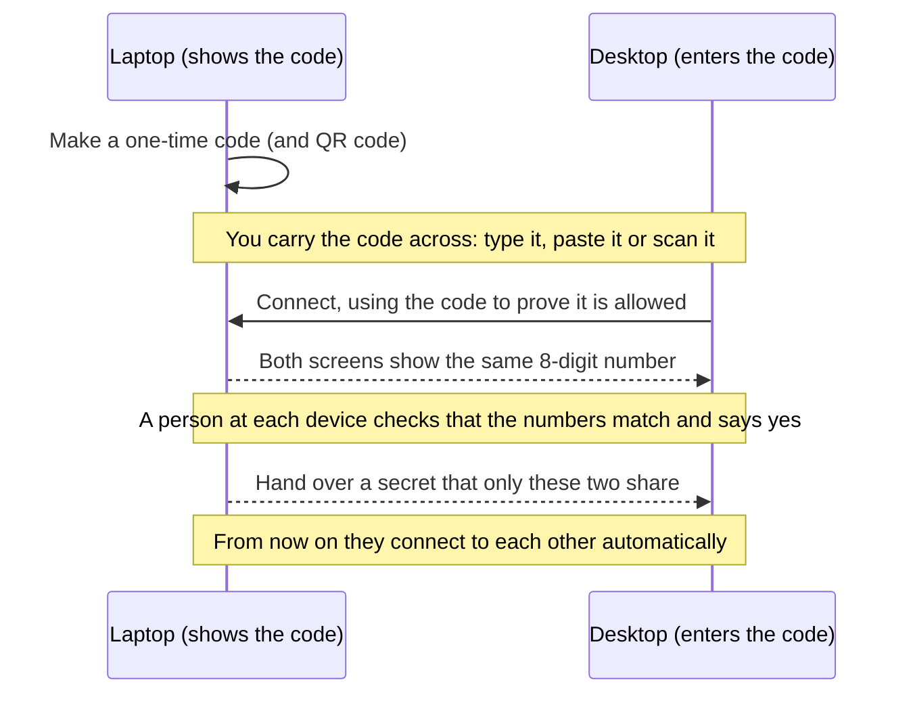
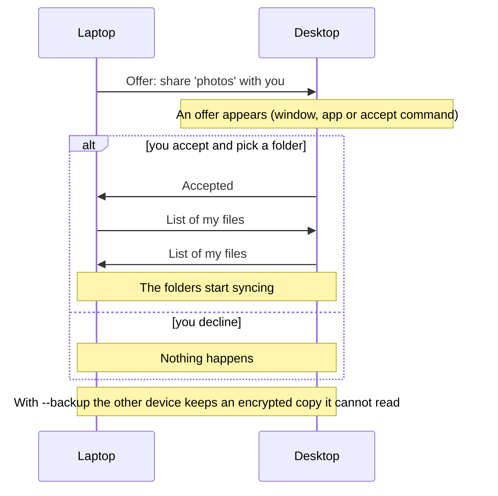
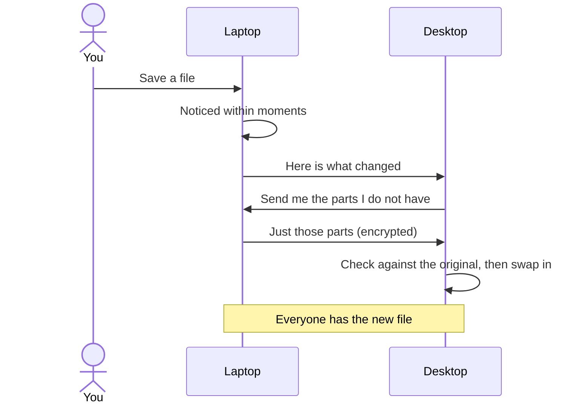
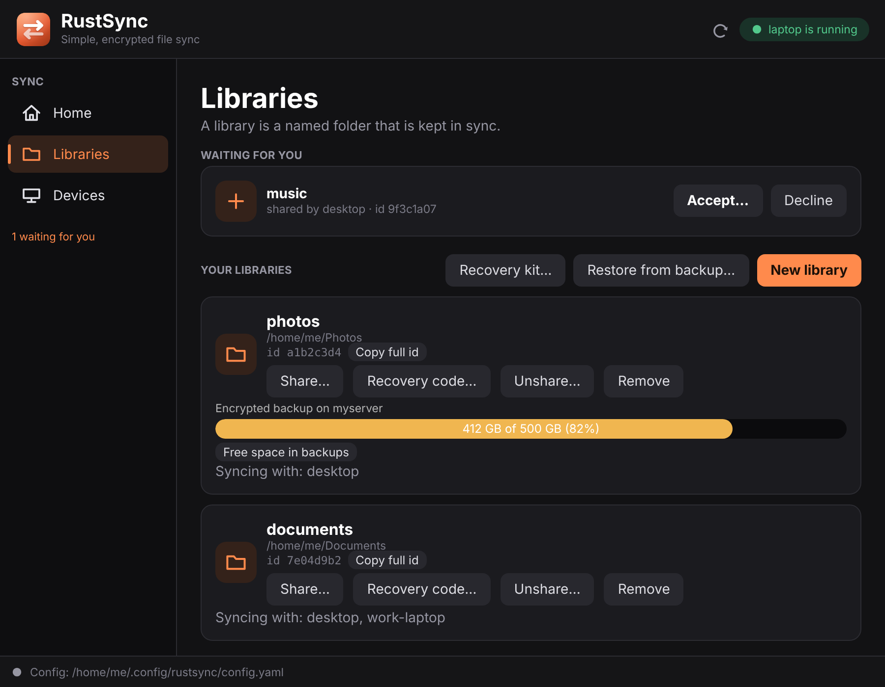
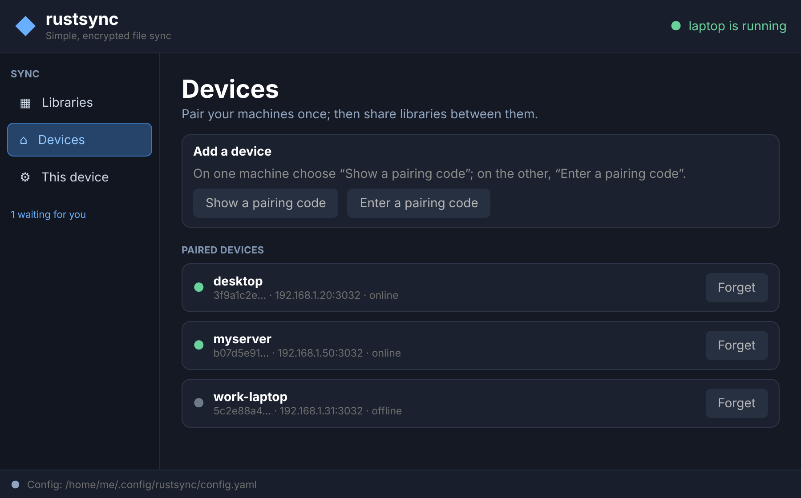
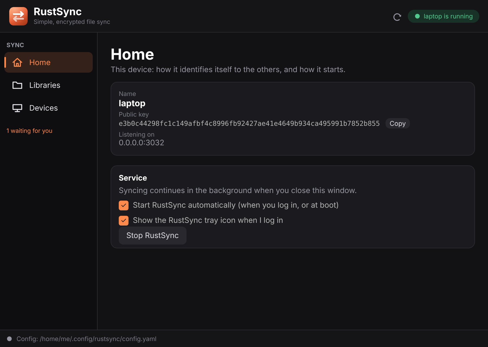
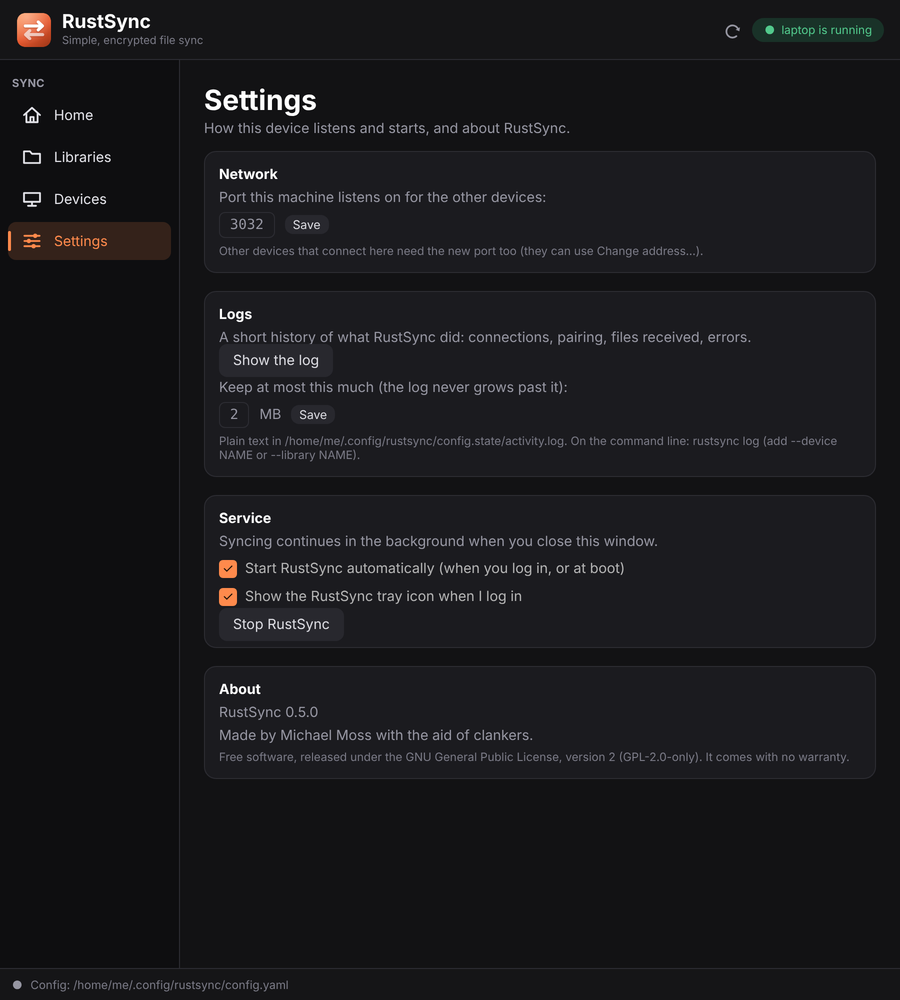
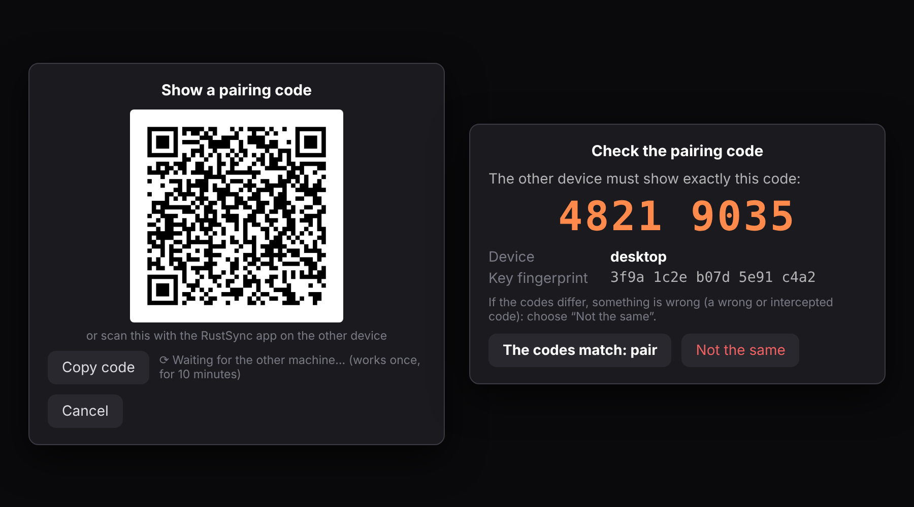
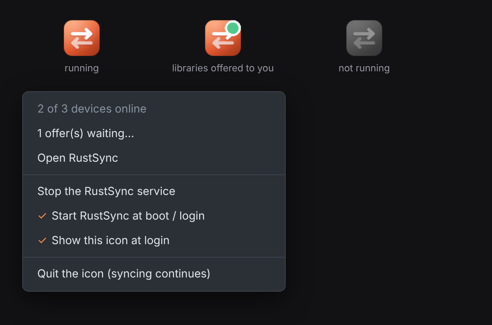
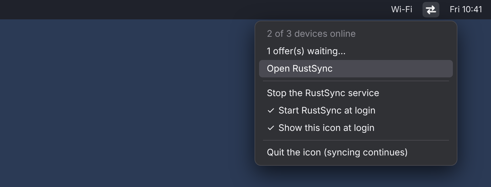

<p align="center"></p>

# !!!VIBE CODED CLANKER CODE!!!

# rustsync

**Simple, end-to-end encrypted file sync between your own computers.** Think of it as a small,
friendly cousin of Syncthing: pick a folder, share it with another machine, and the two keep it
identical. Nothing goes through anybody's cloud.

> **Please read this first.** This project was written almost entirely by an AI assistant and has
> had very little human review or real-world testing. It is a hobby project. Don't make it the only
> copy of anything you care about, and read [`SECURITY.md`](SECURITY.md) before you trust it.

- **Private by default.** Machines only talk to devices you paired yourself, over an encrypted
  connection. Strangers are dropped during the handshake.
- **Simple.** No accounts, no servers to sign up for, no config files to hand-edit. Pair with a
  one-time code, share a folder, done.
- **Encrypted backups.** Give a server an *encrypted* copy of a folder that it cannot read, and
  restore from it if every machine is lost.
- **Command line and a desktop window.** Everything the window does, the command line can do too.
  There is a tray icon on Linux and the BSDs, and an icon in the menu bar on macOS.

Contents: [How it works](#how-it-works-in-one-minute) ·
[Compared with Syncthing](#how-rustsync-differs-from-syncthing) · [Design](#design-simple-and-managed-from-the-tool) ·
[Install](#install) · [Quick start](#quick-start-two-machines-one-folder) ·
[The desktop window](#the-desktop-window) · [All commands](#all-commands) ·
[Starting by itself and the tray icon](#starting-by-itself-and-the-tray-icon) · [Platform notes](#platform-notes) · [Building and releasing](#building-and-releasing) ·
[Encrypted backups](#encrypted-backups-for-a-server-or-if-everything-is-lost) ·
[Troubleshooting](#troubleshooting)

---

## How it works in one minute

Four words are all you need:

| Word | What it means |
|---|---|
| **Device** | One machine running rustsync (your laptop, your desktop, a home server). Each has a name. |
| **Pairing** | Introducing two devices once. One shows a **one-time code** (or a QR code), the other enters or scans it, and you check that both screens show the same short number. After that they trust each other, and no one else. |
| **Library** | A named folder you sync, e.g. `photos` → `~/Photos`. You can have as many as you like. |
| **Sharing** | Offering a library to a paired device. The other side **accepts** it and picks a folder for it. Either it **syncs** the files, or (with `--backup`) it only keeps an **encrypted backup** it cannot read. |

```
  laptop                             desktop
 ~/Photos  <──── encrypted ────>   ~/Pictures/Photos      ← "photos" library, kept in sync
     │
     └──── encrypted backup ────>   home server            ← can't read it, only stores it
```

A small background program (the **service**) does the syncing. The command line and the desktop
window are just remote controls for it: you can close the window, or log out of the terminal, and
syncing carries on.

## How it works, in pictures

Three short diagrams: how two devices get introduced, how a library is shared, and how a changed
file reaches the other side. (Every step, message and check is in [SECURITY.md](SECURITY.md#how-it-works-in-detail).)

**Pairing: introducing two devices, once**



**Sharing a library**



**Syncing: what happens when you save a file**



If two devices change the same file at about the same time, the most recent change wins (so keep
the clocks right). A scan of every folder also runs regularly as a safety net.

## How rustsync differs from Syncthing

rustsync is inspired by [Syncthing](https://syncthing.net) and does the same basic job: keep folders
identical on machines you own, with no central server. Syncthing is excellent, mature and widely used.
**If you need something dependable today, use Syncthing.** rustsync makes different trade-offs, aimed at
being smaller and simpler to set up and run:

| | Syncthing | rustsync |
|---|---|---|
| **Pairing** | Each side adds the other's long device ID and approves it. | One side shows a **one-time code**, the other pastes it. One step, and the code only works once. |
| **Finding each other** | Discovery servers, local discovery, relays and NAT traversal, so devices can find each other almost anywhere. | None. You give the address (a host name or IP and port) when pairing, so the machines must be able to reach each other: same network, a forwarded port, or a VPN or overlay network such as Tailscale. |
| **Encryption** | TLS with a certificate per device. | The Noise protocol, with an extra secret shared only by each pair of devices mixed into every key. |
| **Backups on a machine you don't trust** | "Untrusted" devices can hold encrypted folders. | Built in as a library mode (`share --backup`): the server stores only encrypted data, your other machines find and use the backup by themselves, it has a size limit and a clean-up command, and a **recovery code or kit** gets everything back if every machine is lost. |
| **Managing it** | A web interface in your browser, plus a settings file. | A command line and a native desktop window, both talking to the same background service. Devices and libraries are managed with commands, not by editing a file. |
| **Folder roles** | Send and receive, send only, or receive only, per folder. | Each library is either synced both ways or an encrypted backup. No send-only or receive-only yet. |
| **Conflicts** | Keeps both versions (a conflict copy). | The most recent change wins, by the clock; no copy of the loser is kept. Keep clocks in sync. |
| **File versioning, ignore patterns** | Yes. | No. |
| **Platforms** | Windows, macOS, Linux, the BSDs, Android and more. | Linux, macOS and the BSDs on 64-bit Intel/AMD and ARM. No Windows or Android yet. |
| **Maturity** | Years of use and a large community. | Brand new, written by an AI, little real-world testing. |
| **Language** | Go. | Rust. |

In short: pick Syncthing for reach (Windows, phones, devices behind firewalls with no VPN), fine-grained
folder options and a track record. Try rustsync if you like a small tool you run from the terminal, a
pairing step that is one copy and paste, and an encrypted backup server with a real way to recover.

## Design: simple and managed from the tool

rustsync borrows the feel of [Tailscale](https://tailscale.com)'s command line (it isn't affiliated
with Tailscale): a background service plus one small tool that does everything, with short commands
you can guess, plain-language output, and as little setup as possible. In practice:

- **One tool, a few verbs.** `start`, `status`, `invite`, `join`, `create`, `share`, `accept`: you
  rarely need the manual, and `rustsync --help` lists them all.
- **It asks for what's missing.** Leave a device, library or code off a command and it shows you the
  choices (or asks) instead of failing with a usage message.
- **Everything is managed from the tool itself.** Pairing, libraries, sharing, size limits, recovery
  codes and start-at-login are all commands (or buttons in the window). There's no file you must hand-edit:
  the config file only holds a few optional settings, and devices and libraries live in the service's own
  state, which the commands change for you.
- **The window is just a remote control.** It does nothing the command line can't, so you can use
  whichever you prefer, or both, and closing it never stops syncing.
- **It offers to set itself up.** The first time you start it at a terminal, it offers to start
  automatically at login (and at boot on Linux), the way you'd expect a well-behaved service to.

## Install

You need [Rust](https://rustup.rs) (1.81 or newer).

**Where it runs** (64-bit Intel/AMD `x86_64` and ARM `aarch64`):

| | Sync service and command line | Window | Tray icon | Starts by itself |
|---|---|---|---|---|
| **Linux** | yes | yes (X11 and Wayland) | yes | systemd user service (at login, or at boot) |
| **macOS** (Apple silicon and Intel) | yes | yes | yes (menu bar) | launch agent (at login) |
| **FreeBSD, OpenBSD, NetBSD** | yes | yes (X11 and Wayland) | yes, on desktops with a tray | login entry for the desktop; cron `@reboot` for servers |
| **Android** (64-bit ARM phones) | yes, inside the app | the app | no | a notification keeps it running; restarts after a reboot |

The Android app is new and only roughly tested: see [The Android app](#the-android-app). Windows is not supported (the service uses Unix sockets).

Linux is the system this was written on; the macOS and BSD support is newer and has had less
use, so expect rough edges and please report them. See [Platform notes](#platform-notes) below.

```sh
git clone https://github.com/mrmoss/rustsync
cd rustsync
cargo build --release
```

On Debian, Ubuntu and relatives, the easiest way is the `.deb` from the
[Releases page](https://github.com/mrmoss/rustsync/releases) (needs Ubuntu 22.04, Debian 12 or newer):

```sh
sudo apt install ./rustsync_0.1.0_amd64.deb      # arm64 for ARM machines
rustsync install-service                          # optional: start by itself
```

It installs both programs into `/usr/bin`, a *RustSync* entry in your applications menu, and the
docs. Remove it with `sudo apt remove rustsync` (your config and synced files are left alone).
To make one yourself, `just deb`.

On a **server** (or any Linux, old or new, including Alpine), download
`rustsync-<version>-linux-<cpu>-static.tar.gz` from the same page: just the command-line program,
fully static, so it needs no libraries and no particular Linux version. It has no window, and names
that need the system's name-service plugins (mDNS `.local` names) do not resolve in it; use an IP
address or an ordinary DNS name. `just package-static` makes one.

Or, if you have [`just`](https://github.com/casey/just), `just install` builds and copies both
programs into `~/.local/bin` for you. Ready-made downloads for each system are on the
[Releases page](https://github.com/mrmoss/rustsync/releases) once one has been published.

The build makes two programs in `target/release/`:

| Program | What it is |
|---|---|
| `rustsync` | the sync service and the command line |
| `rustsync-gui` | an optional desktop window (and tray icon) that controls the same service |

On a server with no screen, skip the window and its libraries:

```sh
cargo build --release --no-default-features
```

The window can also read a pairing QR code with the camera (Linux and macOS). That part is the
`camera` feature, on by default. If it gives you trouble to build, leave it out and everything
else still works (you can type or paste the code instead):

```sh
cargo build --release --no-default-features --features gui,tray
```

Put both programs somewhere on your `PATH` (for example `~/.local/bin`), **next to each other**:
the window looks for `rustsync` beside itself first.

## Quick start: two machines, one folder

You'll do the same few steps on both machines. Every command asks for whatever it needs if you
leave it out, so you can't really get it wrong. The examples call the machines **laptop** and
**desktop**.

**1. Start the service on both machines**

```sh
rustsync start
```

The first time, it asks which port to listen on (the default, 3032, is fine), creates its config
and keys, and names the device after the machine's host name. On Linux it also offers to start by
itself when you log in. After that it keeps running in the background.

**2. Pair them (once)**

On the laptop:

```sh
rustsync invite
```

It asks which address the other machine should use to reach this one (a name like `laptop` or an
address like `192.168.1.20` both work), then prints a **one-time code** with a **QR code** under
it, and waits. (Add `--no-qr` to skip the picture, or `--light-terminal` if your terminal has a
light background; the picture is drawn for dark ones.) On the desktop, paste the code:

```sh
rustsync join
```

(The command line can show a QR code but not read one. To scan one, use the window or the Android
app.)

**Both machines now show a short verification code, for example `4821 9035`, and the other
machine's name and key fingerprint.** Look at the two screens: if the numbers are the same, answer
yes on both. If they differ, or you did not just start pairing yourself, answer no. Nothing is
trusted until *both* sides say yes. This is what makes sure you paired the machine you meant to,
even if someone saw or copied the code. See [Security](#security).

The two machines are now paired.

**3. Create a library and share it**

On the laptop:

```sh
rustsync create photos ~/Photos     # a library called "photos"
rustsync share photos desktop       # offer it to the desktop
```

**4. Accept it**

On the desktop:

```sh
rustsync accept                     # shows the offer; asks which folder to put it in
```

That's it: the folders now stay in sync, in both directions. Look at what's going on any time with:

```sh
rustsync status
```

## The desktop window

Prefer clicking? Start the window with `rustsync-gui` (it has a *Start* button if the service isn't
running yet). It has four pages, and opens on the first:

- **Home**: this device: its name, public key and the address it's listening on.
- **Libraries**: your libraries, who they're shared with, how much encrypted-backup space is used,
  and offers waiting for you to accept.
- **Devices**: the machines you've paired and whether they're online, plus *Show a pairing code* and
  *Enter a pairing code* for adding another. When you show a code, the address comes from a
  drop-down of this machine's own IP addresses and host names, or *Set manually…* to type one.
  *Change address…* updates where a device is reached when its IP address changes (the Android
  app has the same button). A device that is offline shows when it was *last seen*, and each
  device and library has a *Log…* button showing just what concerns it.
- **Settings**: the **port** this machine listens on; the **logs** (show them, and set how big
  they may grow); the switches for starting RustSync automatically and for showing its tray (menu
  bar) icon when you log in; and *About* (version, author and license).

Wherever a library needs a folder (*New library*, *Accept…*, *Restore from backup…*), you choose it
with a **folder browser** instead of typing a path: shortcuts for your home folder and drives, a
button to make a new folder, and a switch for hidden folders.

To pair, *Show a pairing code* on one machine: the window shows the code **and a QR code**. On the
other machine, *Enter a pairing code* lets you paste the code or press *Scan its QR code with the
camera* (Linux and macOS; macOS asks permission to use the camera the first time). Then both
windows show the same verification code: compare, and press *The codes match* on both.

The window and the Android app share one look: a dark graphite background with the logo's orange as
the only accent (the Android app also has a light version that follows the phone's setting).

<p align="center">
  
</p>
<p align="center">
  
</p>
<p align="center">
  
</p>
<p align="center">
  
</p>
<p align="center">
  
</p>
<p align="center">
  
</p>
<p align="center">
  
</p>

<sub>These pictures are drawn from the window's layout and colours with made-up example data (names,
paths and sizes), not captured from a real session, so details such as fonts will differ a little on
your machine.</sub>

The window uses `~/.config/rustsync/config.toml` unless you give it another config with
`-c /path/to/config.toml`, the same as the command line.

## All commands

Run `rustsync --help` (or `rustsync <command> --help`) for the full details. Every command takes
`-c <config.toml>` to pick a config file; the default is `~/.config/rustsync/config.toml`. Anything
you leave out is listed and asked for.

```
rustsync [-c CONFIG] <COMMAND>

Getting going
  start               Start the service in the background
  stop                Stop it
  status              Show this device, paired devices (with when an offline one was last seen), libraries and waiting offers
  log [-d DEVICE] [-l LIBRARY] [-n LINES] [--path]
                      Show the activity log (newest last), or just what concerns one device or library;
                      works even when rustsync is not running. `--path` says where the files are
  set-log-size [SIZE] How big the logs may grow, e.g. 5MB (default 2MB)
  install-service     Start rustsync by itself at login (and at boot, on Linux)
  uninstall-service   Stop doing that (also stops rustsync now)

Pairing devices
  invite [--host H] [--no-qr] [--light-terminal]
                      Show a one-time code (and QR code) and wait for another machine to `join`
  join [CODE]         Pair with a machine that is waiting in `invite`
  forget [DEVICE]     Stop syncing with a paired device
  set-address [DEVICE] [HOST[:PORT]]
                      Change the address used to reach a paired device (when its IP changed)
  set-port [PORT]     Change the port this machine listens on (other devices then need
                      `set-address` with the new port)

Libraries (folders to sync)
  create [NAME] [FOLDER]            Create a library from a folder
  remove [LIBRARY]                  Remove it from this machine (files are not deleted)
  share  [LIBRARY] [DEVICE] [--backup]
                                    Offer a library to a paired device: synced, or
                                    (--backup) kept as an encrypted copy it can't read
  unshare [LIBRARY] [DEVICE]        Stop sharing with a device (files stay where they are)
  accept [OFFER] [FOLDER] [--quota SIZE]
                                    Accept a library another device shared with you
  decline [OFFER]                   Say no to an offer
  refresh                           Ask connected devices for their libraries again

Encrypted backups (see below)
  quota [LIBRARY] [SIZE]            Show or change the size limit of a backup kept here
  prune [LIBRARY]                   Delete old, unused data in the backups
  recovery [LIBRARY]                Show the recovery kit / recovery codes
  restore [CODE] [FOLDER] [--from DEVICE]
                                    Get a library back from an encrypted backup
```

Handy things to know:

- **"Number or name":** wherever a command asks for a device, library or offer you can type its
  number from the list, its name, or (for libraries) the start of its id.
- **Options without a command:** `rustsync` on its own runs the service in the foreground (useful
  for watching what it does); `rustsync --show-key` prints this device's public key.
- **Sizes** are written like `500G` or `2T` (decimal: 1 G = 1,000,000,000 bytes), or `none`.

## Starting by itself, and the tray icon

The logo lives in `assets/` (`rustsync-icon.svg`, plus a single-colour `rustsync-symbolic.svg`);
the window, the tray icon and the application-menu entry all use it.

### Starting by itself

```sh
rustsync install-service        # start rustsync by itself
rustsync uninstall-service      # stop doing that (also stops rustsync now)
```

The first time you run `rustsync start` in a terminal it offers this too (once). With it set up,
`start` and `stop` simply work with it. The window's *Settings* page has the same switch.

- **Linux:** a systemd *user* service, `~/.config/systemd/user/rustsync.service` (other configs get
  their own name). It restarts rustsync if it crashes and logs to the usual `daemon.log`.
  `install-service` then offers `loginctl enable-linger`, which is what makes it start at **boot**
  instead of when you log in (`--yes` accepts).
- **macOS:** a launch agent, `~/Library/LaunchAgents/com.rustsync.daemon.plist`. It starts when you
  **log in** and is restarted if it crashes. (Starting before anyone logs in would need a system
  launch daemon, which needs administrator rights; that isn't set up for you.)
- **FreeBSD, OpenBSD, NetBSD:** there is no per-user service manager, so `install-service` adds a
  login entry (`~/.config/autostart/rustsync-daemon.desktop`) that starts rustsync when you log in
  to the desktop. On a **server** with no desktop, the simplest way is cron: run `crontab -e` and add

  ```
  @reboot /usr/local/bin/rustsync -c /home/me/.config/rustsync/config.toml start
  ```

  (use your own paths, and run `rustsync start` once by hand first so the config exists).

### The tray icon (Linux and BSD desktops)

`rustsync-gui` puts an icon in the system tray (StatusNotifierItem over D-Bus). It is in colour
when rustsync is running, **greyed out** when it is not, and gets a **green badge** when libraries
are being offered to you. Click it (or choose *Open RustSync*) to get the window; closing the
window leaves the icon, and syncing, running. The menu also starts or stops the service and has
*Show this icon at login*.

```sh
rustsync-gui --tray      # only the icon, no window (what the login entry runs)
rustsync-gui --no-tray   # only the window
```

The service itself needs no desktop. The tray icon does, so it starts when you **log in to the
desktop** (not at bare boot): `install-service` also adds
`~/.config/autostart/rustsync-tray.desktop` (if `rustsync-gui` sits next to `rustsync`). The first
time the window opens it also adds a `rustsync.desktop` launcher and the icon under
`~/.local/share`, so rustsync shows up in your application menu with its icon (on Wayland that
entry is also what gives the window its icon).

The icon is its own small process, so it behaves the same on X11 and Wayland. It needs a desktop
that shows tray icons: KDE, Cinnamon, LXQt, Ubuntu's GNOME and sway/waybar do; plain GNOME needs the
"AppIndicator" extension; i3 needs `snixembed`. Without one, the icon exits quietly and the window
works as before. At login it waits a few minutes for the panel to be ready; what it did is written
to `tray.log` in the state directory. To build without it:
`cargo build --release --no-default-features --features gui`.

### The menu bar icon (macOS)

On a Mac the same small program puts an icon at the top right of the screen, in the menu bar (no
Dock icon). It follows the light or dark menu bar, is fainter when rustsync is not running, and
gets a dot when libraries are being offered to you. Its menu opens the window, starts or stops the
service, and has *Show this icon at login*. Opening the window (for example from the app) also
shows the icon, and it stays when the window is closed. The *Settings* page has the same login switch;
it adds a launch agent, `~/Library/LaunchAgents/com.rustsync.tray.plist`. To quit the icon, use
its menu.

**Start at login needs the app in a stable place.** A freshly downloaded app that is run straight
from the Downloads folder or a disk image is run by macOS from a temporary, randomised location
that disappears at restart; a login entry pointing there can't start anything. rustsync notices
this, refuses to add the entry, and asks you to move *RustSync.app* into *Applications* first
(then switch the option on again). If it was switched on earlier, switch it off and on again once
the app is in *Applications*. Whether the entries are allowed to run is also shown in *System
Settings → General → Login Items & Extensions*. If you move the app *after* turning it on, the
entries are repaired the next time you open the app and press *Start* (or run `rustsync start`);
the icon's entry repairs itself when the icon runs. Starting rustsync by hand always works, even
if the login entry is broken.

## The Android app

An Android app (a phone or tablet, Android 8 or newer) lives in [`android/`](android/). It runs
the same sync service inside the app, so the phone is a full device: pair it, share libraries
with it, accept ones from the others. It has the same four pages as the window (*Home* first, *Settings* last),
shows a QR code for pairing, and scans one with the camera. To pair, *Devices* opens the camera
straight from the big *Scan a code* button (upright, like any QR scanner); *Show a code on this
phone* shows one for the other device to scan, and a small *Enter a code by hand* link is there
for when a camera isn't handy.

**Get the app.** You don't need to build anything: the `android` GitHub Actions workflow builds an
APK on every push (open the run, download the `dist-android` artifact), and tagged releases have
it attached (`rustsync-<version>-android.apk`). Copy it to the phone and open it; Android asks to
allow installing from that source.

- **Signing key.** Without one, each build is signed with a throw-away key, so a new build can only
  be installed after uninstalling the old one, which **deletes the phone's rustsync identity and
  pairings**. To avoid that, make a key once with `just android-keystore` and add the four
  repository secrets it prints (`ANDROID_KEYSTORE_BASE64`, `ANDROID_KEYSTORE_PASSWORD`,
  `ANDROID_KEY_ALIAS`, `ANDROID_KEY_PASSWORD`). Keep the `rustsync.jks` file safe; it is not in git.
- **Folders.** To sync folders like Documents or Pictures the app needs Android's "all files
  access" (the app asks when you first open it, and the *Home* page has a button if you said
  no). It also asks for notifications and for the camera (to scan pairing codes). Libraries are then
  created from any folder you pick.
- **Staying alive.** The app shows a notification while it runs: that is what lets Android leave it
  running in the background. Phones that aggressively stop apps (battery savers) may need rustsync
  set to "unrestricted" battery use.
- **Reaching the phone.** Other devices connect to the phone, so when you show a pairing code on it
  the address must be one they can reach: pick the Wi-Fi address from the drop-down (it works at
  home) or choose *Set manually…*. The port it listens on can be changed on the *Settings* page.
  Pairing the other way round (phone enters the code) works from anywhere the phone can reach the
  other machine.

**Build it yourself** (JDK 17, the Android SDK and NDK, `gradle`, `cargo install cargo-ndk`):

```sh
just android-apk        # makes dist/rustsync-<version>-android.apk
```

That builds the Rust core for phones (`cargo ndk ... --lib --no-default-features`), then the app
around it with Gradle. You can also open the `android/` folder in Android Studio after running
`just android-core`. The app is Kotlin with Jetpack Compose; `Core.kt` is the only place that
touches the Rust code, and `Control.kt` speaks the same local JSON protocol as the command line.

## Platform notes

**macOS**

- Scanning a pairing QR code in the window uses the camera; macOS asks for permission the first
  time (the app made by `just macos-app` carries the text for that prompt).
- Install the command line tools (`xcode-select --install`) and Rust, then `cargo build --release`.
  A build on Apple silicon makes an Apple-silicon program; to make an Intel one add
  `--target x86_64-apple-darwin` (after `rustup target add x86_64-apple-darwin`), and the other way
  round on an Intel Mac.
- The download is a disk image (`rustsync-<version>-macos-<cpu>.dmg`): open it and drag RustSync
  onto the *Applications* shortcut, then open it from *Applications*. (Running it straight from the
  disk image or Downloads stops it starting at login: see below.) To make the image yourself, run
  `just macos-dmg`; `just macos-app` makes just `dist/RustSync.app` (see
  [Building and releasing](#building-and-releasing)).

  The app is not signed by a developer. One you built yourself opens normally; one you downloaded needs
  a right-click, *Open*, the first time (or *Open Anyway* in System Settings, Privacy & Security, or
  `xattr -dr com.apple.quarantine RustSync.app`).
- macOS asks whether `rustsync` may accept incoming connections the first time it runs: allow it,
  or other machines cannot reach this one.
- The Mac's file system is usually **case-insensitive**, so two files whose names differ only in
  case (`Notes.txt` and `notes.txt`) cannot both exist there. Sync with a Linux machine can
  therefore overwrite one with the other. Also, macOS creates `.DS_Store` files in folders you open
  in Finder, and those get synced like any other file.
- Unix sockets have a shorter path limit on macOS and the BSDs (about 100 characters), so avoid very
  long `state_dir` paths.

**FreeBSD, OpenBSD, NetBSD**

- Install Rust and a C toolchain from your package system (for example `pkg install rust` on
  FreeBSD). The window needs the X11 and/or Wayland and OpenGL development libraries; if the build
  complains about missing ones, install them. On a server, skip all of that with
  `cargo build --release --no-default-features`.
- One safety check works only on Linux and macOS: confirming, through the open file, that it really
  lies inside the library folder. On the BSDs rustsync still refuses symlinks and checks every
  folder on the way, but cannot do that last check, so do not let untrusted local users write to a
  synced folder. See [`SECURITY.md`](SECURITY.md).
- Same case-insensitivity and socket-path notes as above if you use such a file system.

## Building and releasing

A [`justfile`](justfile) wraps the common jobs, so you don't have to remember the steps (get `just`
with `cargo install just`, `brew install just`, or `pkg install just`). Run `just` to see them all:

| Command | What it does |
|---|---|
| `just build` | Build everything in release mode. |
| `just build-server` | Build only the service and command line (no window libraries). |
| `just test` | Run the tests. |
| `just install` | Build and install both programs into `~/.local/bin` (`PREFIX=/usr/local just install` to change it). |
| `just package` | Make `dist/rustsync-<version>-<os>-<cpu>.tar.gz` with the programs and docs. |
| `just package-static` | Linux: the same for the command-line program only, fully static (built with musl). |
| `just macos-app` | On a Mac: make `dist/RustSync.app` (with the logo). |
| `just macos-dmg` | On a Mac: make the `.dmg` disk image to hand out (drag the app into Applications). |
| `just android-apk` | Make `dist/rustsync-<version>-android.apk` (see [The Android app](#the-android-app)). |
| `just android-keystore` | Make the signing key for the Android app, and print the secrets to add on GitHub. |
| `just clean` | Remove build output and `dist/`. |

To build for the other kind of CPU on a Mac, set the target: `TARGET=x86_64-apple-darwin just macos-dmg`.

**Releases are made by GitHub Actions.** Pushing a tag builds the programs for Linux (Intel/AMD and
ARM), macOS (Apple silicon and Intel), FreeBSD and Android, and puts them in a **draft** release:

```sh
# 1. bump `version` in Cargo.toml and commit it
git tag v0.1.0
git push --tags
# 2. wait for the "release" workflow, look over the draft under Releases, then publish it
```

The tag must match the version in `Cargo.toml` or the build stops. The downloads are unsigned and come
with a `SHA256SUMS` file. A separate workflow (`build`) builds and tests every push. For public
repositories, GitHub Actions is free.

## Encrypted backups (for a server, or if everything is lost)

A library can be kept in two ways on another machine. With `share` the other machine syncs the
files like any device. With `share --backup` it only stores an **encrypted** copy it can't read.

```sh
# on the laptop that has the files
rustsync share files myserver --backup

# on the server: you pick where the encrypted data lives (e.g. another drive)
rustsync accept            # asks for a folder; nothing in it can be read on the server
```

- **Pairing later is fine.** If a machine is paired with the server *after* it got the library,
  it asks the machines it is connected to for their lists again and joins the backup by itself.
  `rustsync refresh` (the *Refresh* button) does the same by hand, e.g. if the other machine was
  offline at the time.
- **Other machines use it automatically.** Machines that sync `files` with the laptop learn about
  the backup and join it (if they are paired with the server). So when the laptop writes to the
  server and then goes offline, a machine that was off can start up, talk only to the server, and
  catch up. Changes reach online machines right away; others catch up when they connect.
- **Where it is stored** is chosen per backup when you `accept` (a suggested default is
  `backup_dir:` in the config, or `<state dir>/backups`). It is just a folder; put it on any drive.
- **Unsharing and re-sharing.** `rustsync unshare` (*Unshare…* in the window) stops sharing a
  library with a device; the files stay on both sides. Removing a library on one machine also tells
  the others, so the owner can simply `share` it again and you `accept` it again. For a backup you
  stopped serving, the device's next request shows up as an offer on the server (*Allow* /
  `accept`) and needs no new folder.
- **Size limit.** `accept` asks how much space the backup may use (e.g. `500G`, `2T`, empty = no
  limit). Change it any time with `rustsync quota` (or *Set limit…* in the window). `rustsync
  status` and the window show a usage bar on the server and on the machines that use it. At the
  limit new data is refused (what is stored stays); the bar turns red and says so.
- **Freeing space.** Old versions of changed or deleted files leave unused chunks in the backup.
  `rustsync prune` (*Free space in backups* in the window), run on a machine that has the files,
  deletes chunks nothing refers to any more, but only ones unused for over 7 days. It also runs by
  itself (at most hourly) when a backup is over 90 % full. If anything can't be read, nothing is
  deleted.
- **Library ids.** The server never learns library names; it calls a backup `backup-<id>`. Every
  library shows its short `id` in `status` and in the window (with *Copy full id*), so you can match
  them up.

### If every machine is lost

```sh
rustsync recovery               # run on a machine that has the files, BEFORE disaster strikes
```

prints a **recovery kit**: one line (`rsk1-…`) with every library's id, name and key, plus an
`rsr1-…` code per library. **Save the kit in a password manager** (a secure note in Bitwarden or
similar is fine). It does not contain this machine's identity: a replacement is simply paired again.

On a new machine, pair it with the server (`invite` on the server, `join` here), then:

```sh
rustsync restore                # asks for the kit (or one code), an empty folder, and the server
```

Every library in the kit comes back into its own subfolder, with its name. The server lets the new
machine in because the kit proves it holds the keys. (A library the server keeps no backup of stays
empty.) The window has the same: *Recovery kit…* and *Restore from backup…* on the Libraries page,
*Recovery code…* on a single library.

## Configuration

You rarely need to touch it: devices and libraries are **not** stored in the config file, you
manage them with the commands above. Everything in it is optional:

```toml
name = "laptop"           # what other devices call this one (default: the host name)

# state_dir = "/somewhere/else"        # where keys, pairings and indexes live
# backup_dir = "/mnt/big/backups"      # suggested place for encrypted backups kept on this machine
# accept_backups = true                # show offers to keep encrypted backups here

[server]
port = 3032               # port to listen on (or use `rustsync set-port`, or Settings > Network)

[sync_options]
full_scan_interval = 30   # seconds between full re-scans (changes are also noticed instantly)

[logging]
level = "info"            # debug / info / warn / error
max_size = "2MB"          # most the logs may use (or use `rustsync set-log-size`, or Settings > Logs)
```

**Upgrading from before 0.6.** The config used to be YAML (`config.yaml`). The first time a newer
version starts with an old one it writes a `config.toml` next to it with the same settings and
comments, and uses that from then on; the old file is left where it is and is no longer read. The
same version also changed the messages devices send each other, so **all your devices must be
updated**: an old and a new version refuse to connect to each other (nothing is lost or
corrupted; they just do not talk until both are updated). Encrypted backups made by older versions
are still readable.

**Logs.** rustsync keeps a short history in the state directory as plain text, `activity.log`
(when it grows past half the limit it is moved to `activity.log.1` and the older one is dropped, so
the two together stay under `logging.max_size`, 2MB unless you change it). `daemon.log`, which holds
what the program prints, is cut back to the same limit. One line per event; lines about a device or
library say which:

```
2026-11-01T09:12:03Z INFO  device="laptop" library="photos" received 12 change(s)
2026-11-01T09:12:09Z WARN  device="server" connection to 10.0.0.5:3032 ended: ...
```

so on a server `tail -f`, `grep 'device="laptop"'` and `rustsync log --device laptop` all work.
Times are UTC. `rustsync log --path` prints where the files are.

**Where things live:** the config is `~/.config/rustsync/config.toml`. Keys, pairings, library
information and the log (`daemon.log`) live in the *state directory*, which sits next to the config
file (`config.state/` for the default one) unless you set `state_dir`. Your library folders are
wherever you chose; rustsync only keeps its own bookkeeping in the state directory.

To run **several devices on one machine** (handy for testing), give each its own config with a
different `name` and `server.port`, and pass `-c` to every command.

## Troubleshooting

| Problem | Try |
|---|---|
| `rustsync is not running for this config` | `rustsync start` (use the same `-c` as before). |
| The window can't start the service | Put `rustsync` next to `rustsync-gui` or on your `PATH`, or set `RUSTSYNC_BIN=/path/to/rustsync`. |
| Start at login doesn't start anything (macOS) | Move *RustSync.app* to *Applications*, then switch the option off and on again; check *Login Items & Extensions* in System Settings and `daemon.log` in the state directory. |
| Pairing fails | The code is one-time and only valid while `invite` is still waiting. Check the address you gave to `invite` is reachable from the other machine, and that the port (default 3032) isn't blocked by a firewall. |
| The two verification codes differ | Answer no on both and start again. A different number means the two machines did not talk to each other directly, or someone else used the code first. |
| The camera does not open (window) | Use the pasted code instead. On Linux the camera must be a normal video device (`/dev/video0`) your user can open; on macOS allow the camera in System Settings, Privacy & Security. |
| A device shows as offline | It must be running and reachable at the address it was paired with. Changes sync when it comes back. |
| Nothing happens after `share` | The other side has to `accept` (look in `rustsync status` or the window for the offer). |
| A backup stopped accepting data | It reached its size limit: raise it with `rustsync quota`, or free space with `rustsync prune`. |
| No tray icon | Your desktop may not show tray icons (see the list above); look at `tray.log` in the state directory. |
| Anything else | Run `rustsync log` (or press *Log…* on a device or library in the window, or *Settings → Logs*). `rustsync log --path` says where the files are; `daemon.log` in the state directory holds what the program prints. Run `rustsync` in a terminal (no command) to watch it live. Set `logging.level: debug` for more detail. |

## Security

Pairing is the trust step: only devices you paired can connect, over a Noise-protocol handshake
(X25519, ChaCha20-Poly1305, BLAKE2s) with an extra per-pair secret. Pairing needs the one-time code
(which also carries the inviting machine's key, so the joining machine knows it reached the right
one) and then a person on **each** machine confirming the same verification code. A device you only back up to
never sees your files, names or keys. The details, and what is and isn't protected, are in
[`SECURITY.md`](SECURITY.md), which also walks through each step (connecting, pairing, sharing, syncing,
backups) with diagrams.

Remember the note at the top: this code is AI-generated and has not been independently audited.

## License

rustsync is free software, released under the [GNU General Public License, version 2](LICENSE)
(`GPL-2.0-only`). You may use, study, change and share it under those terms; there is no warranty.