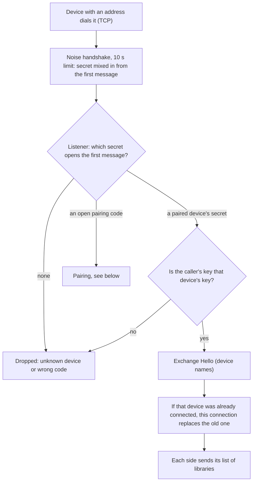
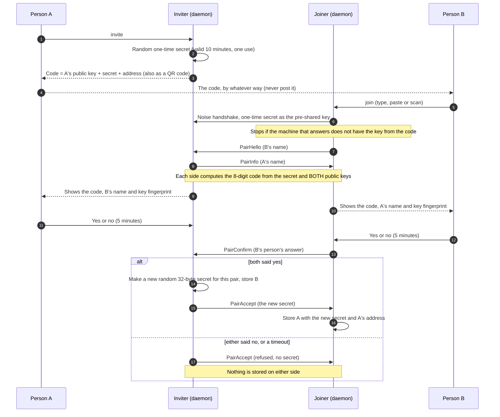
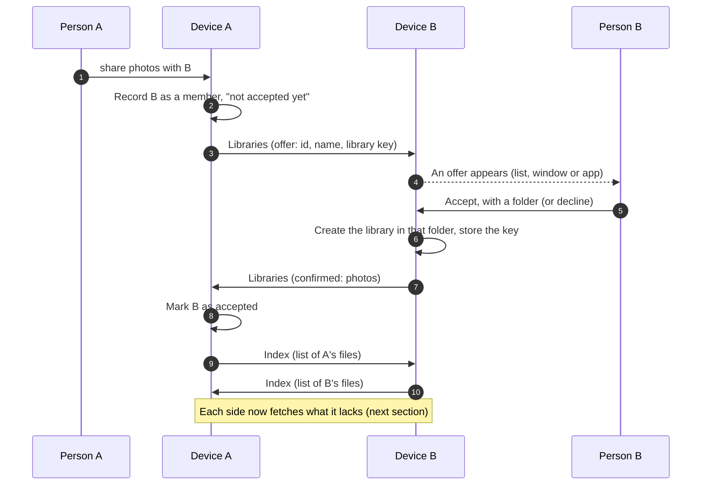
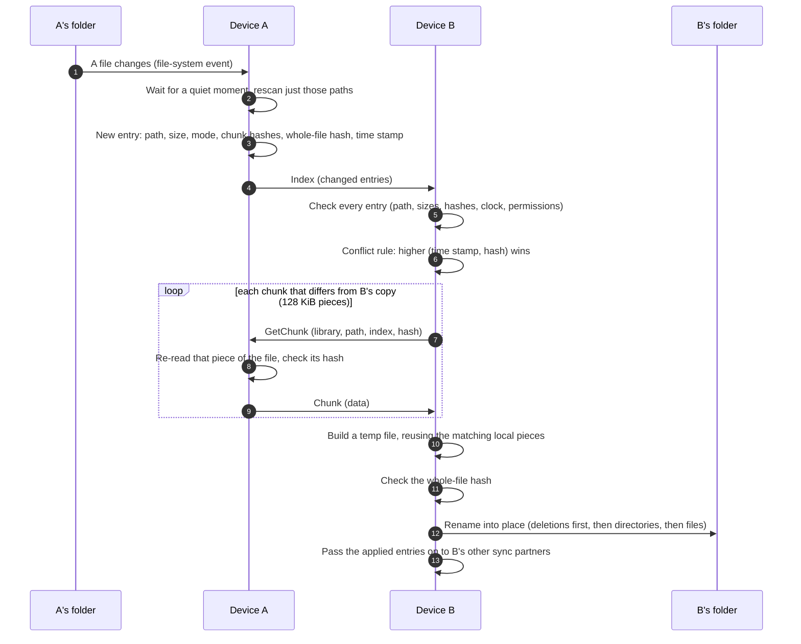
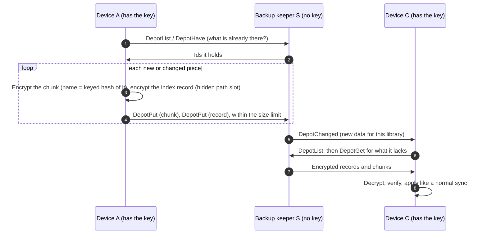

# Security notes

## Trust model

- **Pairing is the trust step.** Only devices you paired (one-time code, then a per-pair secret
  mixed into a Noise XX handshake with X25519 + ChaCha20-Poly1305 + BLAKE2s) can connect.
  Strangers are dropped during the handshake.
- **How pairing is protected.** The pairing code (also shown as a QR code) holds the inviting
  device's public key, a random one-time secret and its address. The joining device only goes on
  if the machine it reaches proves it owns that key, so it cannot be tricked into pairing with an
  impostor. The secret is single-use and expires after 10 minutes. But anyone who *sees* the code
  (a screenshot, a shoulder-surfer, a chat it was pasted into) could use it first, so nothing is
  trusted on the code alone: both devices derive an 8-digit verification code from the secret and
  both public keys, show it with the other device's name and key fingerprint, and **a person on
  each side must confirm they match** before the per-pair secret is handed over or any device is
  stored. An uninvited joiner shows up on the inviting device as a request that has no matching
  code on any screen of yours, and the answer is no. Treat the code like a password until it has
  been used, do not post it anywhere, and answer no whenever you did not just start pairing yourself.
  Limits: the 8 digits are a guard for a person comparing two screens, not a secret, and a person
  who clicks yes without looking defeats it. Pairing messages changed (all your devices need the
  new version to pair again; already paired devices keep working).
- **A device you share a library with, for syncing, can change that library's files on this
  machine.** That is what syncing means. A device that only keeps an *encrypted backup*
  (`share --backup`) has no write access to your files at all: it never receives the key, the
  library name or any plaintext, and plain updates from it are ignored.
- **Who may use an encrypted backup.** The machine that keeps it decides: the first offer has to be
  accepted by hand (`accept`, where you also choose the folder). Afterwards a paired device is let
  in without asking only if it proves it holds the library's key (a value derived from the key with
  BLAKE3; the key itself is never sent). This is how your other machines, and a replacement machine
  after a loss, reach the backup.
- **Membership stays in step.** Each device lists the libraries it holds for the other. A device
  that stops listing one (library removed, or unshared) is dropped as a member on the other side.
  A device you unshared is not added back by other devices' hints about backups, and for a backup
  you keep it must be allowed again by hand. Anyone holding a library's key can still ask for
  access to its backup, so unsharing is housekeeping, not revocation: to lock out a key holder,
  make a new library.
- **Recovery kit and codes** (`rustsync recovery`) contain library ids, names and keys. Anyone with
  a kit or code *and* a copy of the encrypted backup can read the library, so keep them in a
  password manager (a secure note is fine; it is encrypted there). They never appear in logs or the
  status output. The kit holds no device identity or pairing secrets, so losing it to someone does
  not let them impersonate your machines, and restoring needs a fresh pairing.
- Nothing from another device is trusted blindly. Everything below is checked first.

## How it works in detail

These are the same flows as the README's pictures, with the messages and checks spelled out. All of
them travel over the encrypted connection described first; nothing is ever sent in the clear.

### Connecting

Every connection, whether for pairing or for syncing, is a Noise `XXpsk0_25519_ChaChaPoly_BLAKE2s`
handshake. The listening side does not know who is calling, so it tries each secret it holds (one
per paired device, plus any open pairing code) against the first handshake message: only the right
secret decrypts it.

- **Who dials.** A device dials the address it has stored for another device (and redials with a
  growing delay, up to 15 s). The device that *showed* the pairing code stores no address, so it waits for
  the joiner to call; give it one with `set-address` if it should dial too.
- **Before the handshake finishes** a connection counts as anonymous: at most 32 at once, 4 per
  IP address, 10 s to complete. Frames are `[u16 length][ciphertext]`, records carry up to 60,000
  bytes of payload, and a message is capped at 24 MiB.

### Pairing

- The one-time secret is removed from the list the moment a connection uses it, so a second
  attempt gets "this invite was already used".
- Someone who saw the code can connect (step 6) but cannot get the pair secret (steps 14-15)
  without a person on **each** side approving (steps 11-12). Someone in the middle who relays the connection has different keys,
  so the two screens would not show the same number.
- After this, the one-time secret is useless; the per-pair secret from steps 14-15 is what protects
  every later connection between these two devices.

### Sharing a library and accepting it

Device lists are exchanged in a `Libraries` message: what I have confirmed with you, what I am
offering you, and (for syncing partners only) where backups of a shared library are kept.

- **Syncing offer** (`share`): carries the library's name and its key, over the encrypted
  connection. The other side becomes a full member and can change the files.
- **Encrypted-backup offer** (`share --backup`): carries **no** name and **no** key, only a proof
  that the sender knows the key (a BLAKE3 value derived from it). The other side picks a folder and
  stores data it can never read.
- **Offers are checked** when they arrive: ids must be valid, backup offers are ignored if the
  machine has `accept_backups: false`, and only a backup it already keeps *and* whose proof
  matches is let in without asking. A device you unshared is asked about again.
- **Membership stays in step**: a device that stops listing a library is dropped as a member
  on the other side.

### Syncing

- A **full scan** and re-announcement of every index also runs on a timer
  (`sync_options.full_scan_interval`), which catches anything the file watcher missed.
- Requests are limited: 16 chunk requests served at once per device, bounded queues, and an
  oversized or too-fast index is refused or skipped until the next full scan.
- A device that only keeps an encrypted backup of a library cannot send `Index` or `GetChunk` for
  it: those messages are ignored.

### Encrypted backups

A backup keeper (the "depot") holds encrypted pieces and has no key. Everything is sealed with
XChaCha20-Poly1305 using keys derived (BLAKE3) from the library key, which it never gets.

What S can see: how many files there are, when they changed, piece sizes and which pieces are
identical. It cannot see names, paths, contents or permissions. Restoring after losing every
machine (`restore`, with a recovery code or kit) is the same `DepotList` / `DepotGet` flow, started
by a new device that holds the key. A damaged or tampered piece fails to decrypt and is reported,
never applied silently.

## What is enforced

| Area | Protection |
|---|---|
| Paths | Absolute paths, `..`, `.`, empty parts, NUL/control characters, backslashes, over-long names and our temp-file names are rejected (`index::safe_rel`; unit-tested). Local names that cannot be synced are skipped with a warning instead of being sent. |
| Entry contents | Every received entry is validated before use (`index::sanitize_remote`): size must match the chunk count, hashes must be 64 hex characters, deletions/directories must carry no data, files are limited to 16 GiB. |
| Clock tampering | A change time more than `max_clock_skew_secs` (default 24 h) ahead of this machine's clock is ignored, so a wrong or hostile clock cannot make every later edit lose. Stamps use saturating arithmetic (no overflow). |
| Permissions | Modes from other devices are reduced to `rwxr-xr-x` at most: no setuid/setgid/sticky, never group/world writable, and always usable by the owner. |
| Symlinks / races | Files are opened with `O_NOFOLLOW`, and on Linux the open descriptor is checked to really be inside the library folder (`/proc/self/fd`) before reading (scan, serving chunks) or writing (temp files). Symlinked ancestors are refused. |
| Secrets stay out of libraries | A library folder may not contain (or sit inside) the state directory or either key file, or overlap a folder that holds an encrypted backup. Checked when a library is created/accepted *and* every time it starts. A backup folder may not contain the state directory or the key files, and is only reopened if its marker file is still there (an unmounted drive is refused, not treated as empty). |
| Key files | The private key must be a regular file, owned by you, mode 0600 (not a symlink); otherwise rustsync refuses to start. The public key file is always derived from the private key. New keys are created atomically and never overwrite an existing key. |
| Backup size | Each encrypted backup can have a size limit (`quota`) that the machine keeping it enforces on every write, so a paired device cannot fill the drive past it. Unused chunks are only ever deleted by a machine holding the key, only if older than 7 days, and only after every record in the backup was read and decrypted. |
| Memory / CPU | Small bounded queues everywhere a peer controls the input; a byte budget for pending index updates; at most 16 requests per device served at once (extras refused); index messages capped by size and count; library/offer/backup lists capped; a device that stops reading is dropped after 60 s. |
| Temporary files | The files rustsync writes before renaming them into place (in encrypted backups and for the public key) get unpredictable names, are created exclusively (they fail if anything, a symlink included, is already there), are never opened through a symlink, and, for backups, are readable by the owner only. |
| Local control socket | `control.sock` is owner-only (`0600`) in a `0700` directory, and a request is one line of at most 1 MiB. |
| Logs | `activity.log` (and its `.1` copy) are created `0600` in the state directory and capped in size (`logging.max_size`). They hold device and library names, folder paths and error messages, never keys, pairing codes, recovery codes or file contents; line breaks and control characters in names and messages are replaced by spaces, so a hostile device name cannot start a log line of its own. |
| Connection floods | At most 32 unauthenticated connections at once and 4 per IP address, 10 s handshake deadline. |

## Known limits

- A device you sync a library with can still delete or overwrite files **in that library**.
  Only share libraries with machines you trust; use `--backup` for anything that should not
  have write access. (A send-only / receive-only role would be a natural next step.)
- The last step of replacing a file is a `rename`, which cannot be made fully race-free with
  portable APIs. Do not give untrusted local users write access to a synced folder.
- The descriptor check (is the open file really inside the library folder?) works on Linux (`/proc`) and macOS (`F_GETPATH`). On FreeBSD, OpenBSD and NetBSD only `O_NOFOLLOW` and the ancestor checks guard against a symlink being swapped in while a file is replaced, so do not let untrusted local users write to a synced folder there.
- On case-insensitive file systems (the macOS default) a peer's files whose names differ only in case collide: one replaces the other. They stay inside the library, but a sync between such a machine and a case-sensitive one can lose one of the two files.
- An encrypted backup cannot check its own contents (it has no key). If a stored chunk is damaged, or a machine holding the library key uploaded a bad one first, the backup keeps it: restoring that file fails (it is detected, not silently wrong) until the chunk is deleted and uploaded again. There is no automatic repair yet.
- Treat "holds the library key" as "fully trusted for that backup": such a device can already read, delete and overwrite everything in it.
- Size limits are per backup and optional; with none set, a paired device that may back up there can fill the drive. The limit counts the bytes rustsync stores, not other files on the same drive.
- A recovery code is per library and does not change; save it once. Losing every machine *and* every code means the encrypted backup cannot be opened (that is the point).
- Library names are not sent to a machine that only keeps a backup (its offer shows `backup-<id>`); every library shows its id in `status` and the GUI. A restore from a single code takes the name from the folder; a kit carries the names.
- Files larger than 16 GiB are skipped (with a warning).
- Conflict resolution is last-writer-wins on wall-clock time; keep clocks in sync (NTP).
- Dependencies are not audited here: commit `Cargo.lock` and run `cargo audit` regularly.
- **Android.** The app keeps its keys in its private storage (not in the phone's hardware key store), and
  turns off Android's cloud backup for them. Syncing folders outside the app needs "all files access",
  which lets the app (and so anything that can drive it) read and write every file on shared storage:
  only share libraries you mean to. Unless you set your own signing key (see the README), builds are
  signed with a throw-away key and cannot be told apart from a tampered copy by their signature, so
  take the APK from your own repository's builds or releases.
- **QR codes and the camera.** The QR code is the pairing code, so a photo or screenshot of it is as
  sensitive as the text (it works once, and needs a person's approval on both devices, but do not
  post it). The camera reader (window and Android app) only takes a picture while the scan screen is
  open, decodes it locally, and does nothing with the picture afterwards.
